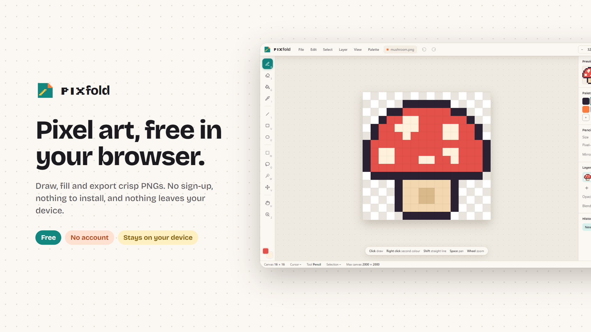

# Pixfold

**A free pixel art editor that runs in your browser.**

   

Pixfold lets you draw pixel art on a computer, with no account and nothing to install. Your drawing stays on your device and is saved automatically, so you can close the tab and pick up where you left off.

**[Open Pixfold](https://direkjames.github.io/Pixfold/)**

## Features

- Pencil, eraser, fill, line, rectangle and ellipse, plus a colour picker
- Pixel-perfect drawing that removes the stray corner pixels in a line
- Mirror drawing: draw on one side and Pixfold draws the other, left to right, top to bottom, or both
- Selections with a rectangle, a lasso or a magic wand, with add and remove modes. Drawing and fill stay inside the selection
- Move, copy, cut, paste, delete, flip and rotate a selection, or a whole layer when nothing is selected
- Brush sizes from 1 to 64 pixels, and filled or outlined shapes
- Canvases from 1×1 up to 2000×2000 pixels
- A colour palette you can add to, edit, reorder and trim, with a strip of recent colours
- Layers: add, duplicate, delete, merge down, reorder by dragging, rename, hide and lock
- Layer opacity and blend modes (Normal, Multiply, Screen, Overlay, Darken, Lighten)
- Save and reopen your work as a project file that keeps every layer
- Unlimited undo and redo, and a history list you can click to jump back to any step
- Smooth zoom and pan, with a pixel grid and a see-through checkerboard
- Open PNG, GIF or WebP images, or drop one onto the canvas
- Export a flattened PNG, or at 2×, 4×, 8× or 16× size for sharing
- Autosave, so your last drawing comes back when you return
- Light, dark and system themes
- Familiar keyboard shortcuts (B, E, G, I, L, U, O, M, Q, W, V, H, Z, X, `[` and `]`, plus Ctrl+A, C, X, V, D)

## Getting started

1. Open Pixfold in Chrome, Edge or Brave on a computer.
2. Press **Ctrl+N** to choose a canvas size, or just start drawing on the default 32×32 canvas.
3. Pick a colour from the palette and draw. Right-click draws with your second colour.
4. Turn on **Mirror** in the options panel to draw symmetrically. Press **M** and drag to select, then **V** to move what you selected.
5. Press **Shift+N** to add a layer. Each layer has its own eye and lock.
6. Press **Ctrl+S** to save a project with all its layers, or **Export PNG** to save the finished picture.

Tip: hold **Space** and drag to move around, scroll to zoom, and hold **Shift** while drawing for a straight line. The colour picker (I) reads what you see; hold **Alt** to read only the selected layer.

A PNG cannot hold layers, so keep the project file if you want to edit them later. The automatic save lives in your browser only, so clearing the site's data removes it. Save a project to keep your work safe.

## Requirements

- A desktop or laptop with a mouse or pen
- A current version of Chrome, Edge or Brave

Pixfold does not work on phones. Other desktop browsers may work but have not been tested; they download the PNG instead of saving straight to a file.

## Built with

TypeScript, Vite and the HTML canvas. Fonts are bundled, so Pixfold makes no requests once it has loaded. See [docs/DEVELOPING.md](docs/DEVELOPING.md) for how to run and build it.

## Status

Active.

## Credits

Fonts: [Bricolage Grotesque](https://fonts.google.com/specimen/Bricolage+Grotesque) and [Silkscreen](https://fonts.google.com/specimen/Silkscreen), both under the SIL Open Font License.
